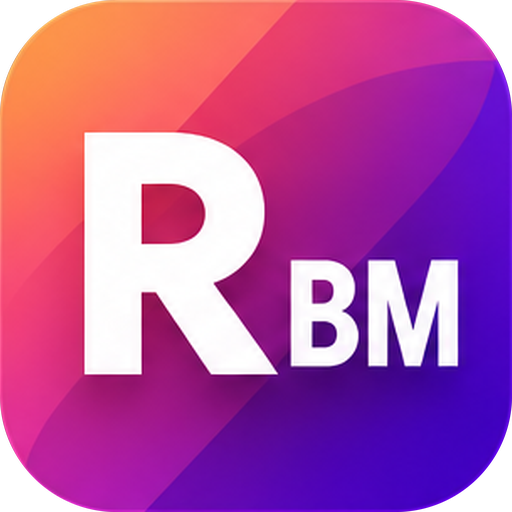
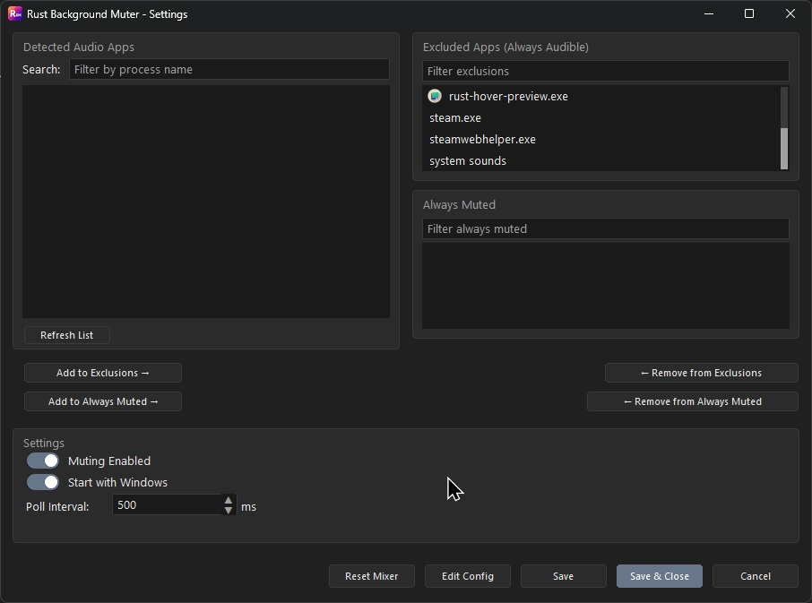

<p align="center">
  
</p>

<h1 align="center">Rust Background Muter</h1>

<p align="center">
  <b>Only the app you are looking at. Everything else goes quiet.</b>
</p>

<p align="center">
  A native Windows tray app that mutes audio from background applications<br/>
  and keeps the foreground app audible — WASAPI, no drivers, sub-1% idle CPU.
</p>

<p align="center">
  <a href="https://github.com/cosmokud/rust-bg-muter/releases/latest"></a>
  
  
  <a href="LICENSE"></a>
</p>

<p align="center">
  <a href="#installation">Install</a> ·
  <a href="#features">Features</a> ·
  <a href="#usage">Usage</a> ·
  <a href="#configuration">Configuration</a> ·
  <a href="#build-from-source">Build</a> ·
  <a href="#architecture">Architecture</a> ·
  <a href="#development">Develop</a> ·
  <a href="CONTRIBUTING.md">Contribute</a>
</p>

---

## Overview

The app runs quietly in the system tray, tracks the current foreground process, and applies muting rules to active audio sessions through WASAPI. It is designed for low overhead and predictable behavior, with settings persisted in a local JSON config file.

<p align="center">
  
</p>

## Features

- Automatic background muting based on the currently focused application
- Excluded apps list to keep selected apps always audible
- Always-muted apps list to force selected apps muted at all times
- Real-time detection of active audio sessions
- Zero GPU/VRAM usage and sub‑1 % idle CPU cost due to the native Win32 window and GDI rendering
- Native system tray controls:
  - Enable or disable muting
  - Open the settings dialog
  - Exit the application
- Tray icon double-click shortcut to open settings
- Native Win32 settings dialog with:
  - Detected audio apps list
  - Search and filtering for detected apps
  - Add/remove flows for Excluded and Always Muted lists
  - Double-click a row to move an app between the detected, excluded and always-muted lists
  - Poll interval steppers (`100`-`2000` ms)
  - Start with Windows toggle
  - `Reset Mixer` to redo the Windows Volume Mixer reset
  - `Edit Config` to open `config.json` in your editor
- Persistent configuration in `%APPDATA%\rust-bg-muter\config.json`
- Automatic unmute cleanup for app-muted sessions on exit

## Installation

Download the latest Windows build from the repository's GitHub Releases tab:

- [GitHub Releases](../../releases)

Every release carries two files:

- `rust-bg-muter_x.y.z_x64-setup.exe` — an installer that places the app in
  `%LOCALAPPDATA%\rust-bg-muter`, adds Start menu and desktop shortcuts, and registers an
  uninstaller. No administrator rights are needed.
- `rust-bg-muter.exe` — the portable executable. Copy it anywhere you like and run it.

Both write the same configuration, at `%APPDATA%\rust-bg-muter\config.json`.

## Usage

1. Launch `rust-bg-muter.exe`.
2. Right-click the tray icon to open the menu.
3. Select **Enable/Disable Muting** as needed.
4. Open **Settings...** to manage app rules and behavior.

## Configuration

Configuration is stored at `%APPDATA%\rust-bg-muter\config.json`.

Example:

```json
{
  "excluded_apps": ["spotify.exe", "discord.exe"],
  "always_muted_apps": ["steam.exe"],
  "muting_enabled": true,
  "poll_interval_ms": 500,
  "minimize_to_tray": true,
  "minimize_button_to_tray": true,
  "start_with_windows": false,
  "window_state": null
}
```

## Build from Source

```bash
git clone https://github.com/cosmokud/rust-bg-muter.git
cd rust-bg-muter
cargo build --release
```

Binary output:

- `target/release/rust-bg-muter.exe`

Windows installer (NSIS, built with [cargo-packager](https://github.com/crabnebula-dev/cargo-packager);
its template is `packaging/nsis/installer.nsi`):

```powershell
.\build-installers.ps1
```

Output: `target/packager/rust-bg-muter_<version>_x64-setup.exe`.

## Architecture

```text
src/
├── main.rs            # App entry point and tray event loop
├── audio.rs           # WASAPI session enumeration and per-process mute control
├── muter.rs           # Foreground-aware muting engine and rules
├── process.rs         # Foreground process detection
├── tray.rs            # Native tray menu and message pump integration
├── settings_dialog.rs # Native Win32 settings UI: layout, painting, input
├── field.rs           # Single-line text field editing rules
├── od_controls.rs     # Ownerdraw paint helpers (toggles, buttons, cards)
├── theme.rs           # Dialog theming, fonts, brushes, icons
├── icon_cache.rs      # Per-executable icon extraction and on-disk cache
├── mixer_reset.rs     # Windows Volume Mixer reset
├── confirm_dialog.rs  # Native confirmation prompt
├── shell.rs           # ShellExecute helper (open config in an editor)
├── config.rs          # JSON config persistence and defaults
└── startup.rs         # Windows startup registry integration
```

## Development

`rust-toolchain.toml` pins the toolchain, so cargo, rustfmt and clippy answer the same on your machine as they do in CI.

```bash
cargo build
cargo test
cargo fmt --all -- --check
cargo clippy --all-targets -- -D warnings
```

See [CONTRIBUTING.md](CONTRIBUTING.md) for setup, the pre-commit tip, and what the checks do not cover.

## Privacy

Rust Background Muter is local-first and has no network code at all: no telemetry, no analytics, no crash reporting, no update checker. It reads which process owns the foreground window and which audio sessions are playing, and mutes by setting each session's own mute flag. Settings and the icon cache live under `%APPDATA%\rust-bg-muter`, and the only registry writes are the app's own startup entry and the per-app volume memory `Reset Mixer` clears, both under `HKEY_CURRENT_USER` and both only when you ask. See [PRIVACY.md](PRIVACY.md) for full details.

## Security

Please report vulnerabilities privately, not in a public issue. See [SECURITY.md](SECURITY.md).

## License

Licensed under the MIT License. See [LICENSE](LICENSE).
